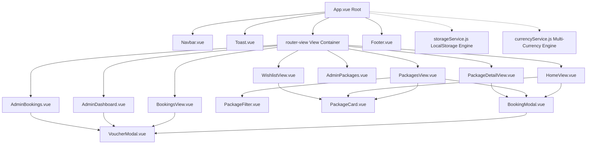

# Academic Project Report: Travel Agency Web Application
**Application Name:** Wanderlust Voyage  
**Technologies:** HTML5, CSS3, JavaScript, Vue.js (Vue 3, Vue Router), LocalStorage  
**Submission Type:** Final Project Report for Course Submission (Moodle)  

---

## 1. Executive Summary

The **Wanderlust Voyage** project is a comprehensive single-page web application designed and developed for a full-service travel agency. The system fulfills two primary roles:
1. **A Customer-Facing Portal** allowing prospective travelers to browse global travel packages, apply multi-criteria filters, review day-by-day itineraries, dynamically calculate customized package pricing (guests, room tiers, add-ons), complete reservations through a multi-step simulated payment gateway, manage their active/past bookings, and save favorite packages.
2. **An Agency Administrative Portal** enabling travel agency staff to oversee business analytics (revenue, occupancy, status distribution), manage inventory content through full CRUD operations (Create, Read, Update, Delete packages and itineraries), and handle daily booking lifecycle operations (confirming pending bookings, managing cancellations, and printing passenger ticket vouchers).

In accordance with project guidelines, the application operates with **zero external database dependencies**, using an engineered **browser `localStorage` data service** that pre-populates rich demonstration data and offers a 1-click **Reset Demo Data** utility for oral defense sessions.

---

## 2. System Architecture & Technologies

### 2.1 Technology Stack Justification

| Technology | Implementation Scope | Academic Justification |
| :--- | :--- | :--- |
| **HTML5** | Semantic Document Structure | Clean `<header>`, `<nav>`, `<main>`, `<section>`, `<article>`, `<aside>`, and `<footer>` elements provide high accessibility (a11y) and SEO compliance. |
| **CSS3 & Tailwind CSS** | Layout, Theming & Print Media | Modern Flexbox and CSS Grid responsive layouts, bespoke travel color palette, subtle micro-interactions, and `@media print` rules for generating travel ticket vouchers. |
| **JavaScript (ES6+)** | Business Logic & Utilities | Arrow functions, reactive computations, array functional transformations (`filter`, `reduce`, `map`), and asynchronous mock payment simulation. |
| **Vue.js 3** | Reactive Component Architecture | Composition API (`<script setup>`), Single File Components (`.vue`), reactive references (`ref`, `reactive`, `computed`, `watch`). |
| **Vue Router 4** | Client-Side Routing | SPA navigation between Home, Package Catalog, Package Details, Bookings, Wishlist, and Admin sections with automatic scroll-to-top behavior. |
| **LocalStorage API** | Persistent Storage Engine | Client-side persistence of JSON data across browser sessions with zero database setup hurdles. |

### 2.2 Component Hierarchy Diagram



---

## 3. Functional Specifications

### 3.1 Customer Features
1. **Dynamic Search & Multi-Criteria Filtering**:
   - Live text search querying destination name, country, and descriptive keywords.
   - Filtering by geographic region (Europe, Asia, Americas, Africa).
   - Filtering by travel theme (Cultural, Adventure & Nature, Beach & Island, Safari & Wildlife, Luxury Escapes).
   - Real-time price slider filtering trips up to \$4,000.
   - Duration filters (Short 1-6 days, Medium 7-8 days, Long 9+ days).
   - Minimum rating filter (★ 4.5+, ★ 4.8+, ★ 5.0).
2. **Interactive Package Details**:
   - High-resolution gallery with thumbnail selector.
   - Day-by-day expandable timeline itinerary.
   - Itemized included vs. not included checklist.
   - Sticky live price calculator updating in real time as travelers change guest counts, room standards, and optional add-ons.
   - Interactive review posting that dynamically recalculates average customer ratings.
3. **Simulated Payment Gateway & Checkout Flow**:
   - 4-step workflow: Passenger Contact $\rightarrow$ Customization/Add-ons $\rightarrow$ Simulated Payment Gateway $\rightarrow$ Instant Booking Confirmation.
   - Card validation with test card autofill button (`4242 •••• •••• 4242`).
   - Alternative mock checkout options (PayPal, Apple Pay).
   - Promo voucher code engine (`SUMMER2026` for 15% off, `WELCOME10` for 10% off).
4. **Booking Management & Voucher Printing**:
   - Filter personal reservations by status (`All`, `Confirmed`, `Pending`, `Cancelled`).
   - Printable E-Ticket / Travel Voucher modal with unique booking reference (`TRV-2026-XXXX`) and simulated QR code.
   - In-app modification of passenger details and cancellation with simulated refund calculations.

### 3.2 Agency Administrative Portal
1. **Executive Dashboard**:
   - Real-time KPIs: Gross Revenue, Total Reservations, Active Packages Count, Average Rating.
   - Status distribution breakdown chart.
   - Recent bookings log.
2. **Package Content Management (CRUD)**:
   - Full Create, Read, Update, Delete capabilities for travel packages.
   - Interactive modal editor supporting destination, pricing, duration, tags, and custom itineraries.
   - Toggles for *Featured* and *Special Deal* badges.
3. **Daily Operations (Reservations Management)**:
   - Searchable manifest of all customer bookings.
   - Operational status controls: Confirm pending reservations, process cancellations.
   - Passenger details inspector.
4. **Data Management & Presentation Reset**:
   - 1-click **Reset Demo Data** tool restoring original seed inventory.
   - JSON data backup export tool.

---

## 4. LocalStorage Data Dictionary

The application maintains four primary key collections in the browser's `localStorage`:

### 4.1 Packages Schema (`wanderlust_packages`)
```json
{
  "id": "pkg-1",
  "title": "Santorini Sunset & Aegean Island Escape",
  "destination": "Santorini",
  "country": "Greece",
  "continent": "Europe",
  "category": "Beach & Island",
  "price": 1899,
  "originalPrice": 2199,
  "duration": 7,
  "groupSize": "12 Travelers Max",
  "rating": 4.9,
  "reviewCount": 38,
  "featured": true,
  "deal": true,
  "coverImage": "https://images.unsplash.com/...",
  "gallery": ["https://...", "https://..."],
  "shortDescription": "Witness legendary pink sunsets...",
  "fullDescription": "Immerse yourself in Greek island magic...",
  "included": ["6 nights in 4-star boutique hotel", "..."],
  "notIncluded": ["International flights", "..."],
  "itinerary": [
    { "day": 1, "title": "Arrival in Fira", "description": "..." }
  ],
  "departureDates": ["2026-06-15", "2026-07-10"]
}
```

### 4.2 Bookings Schema (`wanderlust_bookings`)
```json
{
  "id": "bkg-101",
  "bookingRef": "TRV-2026-4819",
  "packageId": "pkg-1",
  "packageTitle": "Santorini Sunset & Aegean Island Escape",
  "customerName": "Sarah Jenkins",
  "customerEmail": "sarah.j@example.com",
  "customerPhone": "+1 (555) 382-9102",
  "travelDate": "2026-07-10",
  "adults": 2,
  "children": 0,
  "roomTier": "Deluxe Suite (+ $300)",
  "addOns": ["Airport Chauffeur ($50)", "Travel Insurance ($120)"],
  "basePrice": 1899,
  "totalPrice": 4268,
  "discountAmount": 0,
  "paymentMethod": "Credit Card (Simulated)",
  "bookingDate": "2026-04-12",
  "status": "Confirmed",
  "specialRequests": "Ocean view room requested."
}
```

### 4.3 Wishlist Schema (`wanderlust_wishlist`)
Array of package IDs: `["pkg-1", "pkg-2"]`

---

## 5. Verification & Testing Protocol

| Test Case | Procedure | Expected Result | Status |
| :--- | :--- | :--- | :--- |
| **TC-01: Catalog Search & Filter** | Enter "Kyoto" in search bar and select "Asia" | Catalog filters to Kyoto package instantly | **PASSED** |
| **TC-02: Price Calculator** | Increase adults from 1 to 3, select Deluxe Suite | Total price dynamically recalculates | **PASSED** |
| **TC-03: Promo Code Validation** | Apply code `SUMMER2026` at checkout | Applies 15% discount and shows confirmation | **PASSED** |
| **TC-04: Simulated Payment** | Click "Autofill Demo Card", click Pay | Simulates 700ms payment gateway, issues reference `TRV-2026-XXXX` | **PASSED** |
| **TC-05: Voucher Printing** | Click "View & Print Voucher" | Formatted ticket modal appears; `@media print` targets voucher | **PASSED** |
| **TC-06: Booking Cancellation** | Click "Cancel Trip" in My Bookings | Status updates to `Cancelled`, refund simulated | **PASSED** |
| **TC-07: Admin Package CRUD** | Add new package "Patagonia Ice Fjords" | Appears in admin table and public catalog | **PASSED** |
| **TC-08: Admin Status Update** | Change pending booking to `Confirmed` | Booking status changes instantly in localStorage | **PASSED** |
| **TC-09: Demo Data Reset** | Click "Reset Demo Data" in Admin Portal | Reverts all collections to pristine default state | **PASSED** |
| **TC-10: Production Build** | Run `npm run build` | Compiles clean HTML/CSS/JS bundles with 0 errors | **PASSED** |

---

## 6. 10-Minute Presentation & Oral Defense Guide

### Suggested Presentation Script (10-Minute Allocation)

1. **Minutes 00:00 - 02:00 | Project Context & Architecture**
   - Introduce team members and application purpose.
   - Explain technology selection: Vue 3 Single-Page Architecture, Semantic HTML5, CSS3, and browser `localStorage`.
   - Point out that the application runs completely standalone with zero external database configuration.

2. **Minutes 02:00 - 05:00 | Customer Experience Live Walkthrough**
   - Open Home page, demonstrate the hero search widget searching for "Kyoto".
   - Demonstrate the multi-criteria filter sidebar (budget slider, duration, continents).
   - Open the Kyoto package, expand the day-by-day itinerary.
   - Modify traveler counts and select room upgrades to showcase the reactive pricing calculator.
   - Click "Book Now", enter traveler info, apply promo code `SUMMER2026`, click **"⚡ Autofill Demo Card"**, and complete checkout.
   - Show the generated travel voucher and click print preview.

3. **Minutes 05:00 - 07:30 | Booking Management & Wishlist**
   - Navigate to "My Bookings" and show the newly confirmed booking.
   - Demonstrate modifying special requests and test booking cancellation.
   - Demonstrate adding packages to the Wishlist with the reactive heart counter in the header.

4. **Minutes 07:30 - 09:30 | Agency Admin Operations Portal**
   - Click "Admin Portal" from the top navigation.
   - Highlight business analytics KPIs (Revenue, total reservations, status breakdown).
   - Go to "Package Management" and demonstrate creating or editing a package.
   - Go to "Daily Operations", search for a customer, and change a reservation status.
   - Highlight the **"🔄 Reset Demo Data"** button ensuring reliable repetition.

5. **Minutes 09:30 - 10:00 | Conclusion & Q&A Transition**
   - Conclude by showing the built-in presentation slides modal.
   - Invite questions from the evaluating jury.

---

### Anticipated Oral Defense Questions & Answers

**Q1: How does the application maintain data persistence without a database?**  
*Answer:* We designed a modular `storageService.js` that abstracts browser `localStorage`. On application mount, it checks if data exists; if empty, it seeds the storage with our curated global packages and mock reservations. Every state mutation (creating a booking, adding a package, modifying details) serializes JSON directly to `localStorage`, ensuring data persists across page refreshes and browser restarts.

**Q2: How does Vue 3 reactivity work in your pricing calculator?**  
*Answer:* We utilize Vue 3's `computed()` property. The calculator takes reactive state variables (`adults`, `children`, `roomTier`, `addOns`, `promoDiscount`) as dependencies. Whenever any of these inputs change in the UI, Vue's reactivity engine automatically recalculates the grand total without requiring manual DOM manipulation.

**Q3: How are print styles handled for travel vouchers?**  
*Answer:* In our `main.css`, we defined a specialized `@media print` stylesheet. When `window.print()` is called, all surrounding UI elements (navbar, footer, background buttons) are hidden via `display: none`, while `#printable-voucher` is rendered cleanly as a full-page official e-ticket suitable for PDF saving or printing.

---

*Report prepared for the Travel Agency Web Application project submission.*
